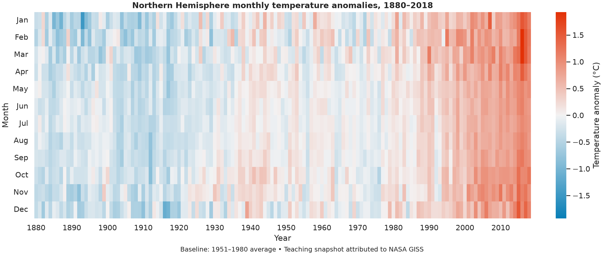
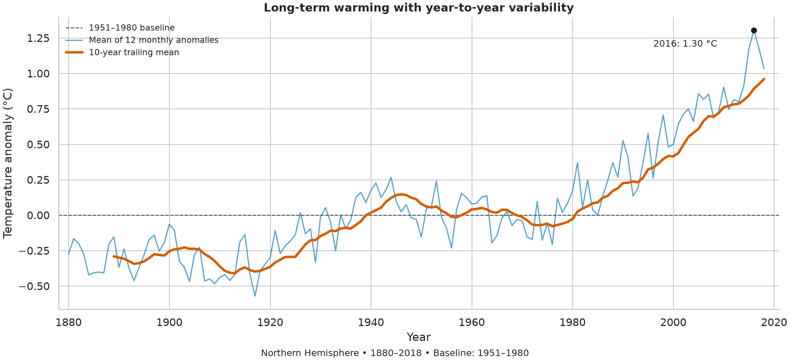

[README.md](https://github.com/user-attachments/files/33472243/README.md)
# Northern Hemisphere Temperature Anomalies

**Research question:** How did Northern Hemisphere surface temperature anomalies change between 1880 and 2018, and what do monthly patterns add to the annual summary?

**Status:** Completed exploratory analysis of a historical teaching snapshot. Updating the source and assessing uncertainty are future work.

## Data and permissions

The input is `northern_surface_temperature.csv`, supplied for CISC7204 Exercise 7.02 and attributed to [NASA GISS Surface Temperature Analysis (GISTEMP)](https://data.giss.nasa.gov/gistemp/). It contains 139 years × 12 months (1,668 observations), with no missing monthly values in the analyzed snapshot. Values are anomalies in degrees Celsius relative to the **1951–1980** average, not absolute temperatures.

NASA-produced data are generally available for public informational use with attribution. Check [NASA's media-use guidelines](https://www.nasa.gov/nasa-brand-center/images-and-media/) and the GISS source's current notices for exceptions. The course CSV's specific redistribution permission has not been independently established. **It is therefore not included in this public repository.** Use your locally obtained course copy or download the current official NASA table with `fetch_data.py`. The latter may contain revisions and will not necessarily reproduce the historical snapshot's exact numbers. Do not upload personal information, keys, restricted data, or the saved Moodle page.

## Methods and tools

Python, pandas, NumPy, Matplotlib and Seaborn are used to:

1. Validate unique integer years, continuous coverage, numeric months and finite values.
2. Transpose the monthly table for a heatmap. A blue-to-red diverging palette has symmetric limits and a neutral zero.
3. Average all 12 monthly anomalies for each complete year. Incomplete years remain missing, not zero.
4. Plot yearly values and a **10-year trailing** moving average. Its first nine values are deliberately absent.
5. Compare the 30-year periods 1880–1909 and 1989–2018.

The annual statistic is an equal-weight monthly mean created for this project, **not NASA's published annual J-D field**. The rolling mean is a descriptive smoother, not a forecast.

## Visualizations and findings



The monthly heatmap shows a broad transition toward positive anomalies in later decades, with differences between months and years. Unlike the classroom plot that sampled every fifth year, this plot includes every year.



In the analyzed snapshot:

- The mean of annual monthly-means is **−0.300 °C** for 1880–1909 and **+0.684 °C** for 1989–2018: a difference of **+0.983 °C**.
- **2016** has the highest annual monthly-mean in this interval, **+1.304 °C**.
- The 2018 annual monthly-mean is **+1.034 °C**.

Numbers describe this Northern Hemisphere snapshot only. They are not claims about the latest dataset, global temperatures, or temperatures at individual locations.

## Limitation and next steps

This descriptive analysis does not incorporate the source's uncertainty estimates and does not attribute warming to particular causes. Historical values can be revised. Aggregation also hides geographic variation. Next steps are to verify the snapshot's release, compare it against the current NASA table, add uncertainty information and consider regional comparisons.

## Reproduce

From the repository root, use Python 3.11 or newer:

```bash
python -m venv .venv
# Windows: .venv\Scripts\activate
# macOS/Linux: source .venv/bin/activate
python -m pip install -r requirements.txt
```

**Option A — reproduce the exact teaching snapshot:** put your copy in `data/northern_surface_temperature.csv`, then:

```bash
python analysis.py
```

Or provide a local path:

```bash
python analysis.py --input "path/to/northern_surface_temperature.csv"
```

**Option B — reproduce the workflow with current official data:** requires internet:

```bash
python fetch_data.py
python analysis.py
```

The script generates two PNGs, `figures/annual_summary.csv`, and `figures/metrics.json`. Check the input hash in the JSON: the teaching snapshot hash is `694b3b10f948ae9b4af22369796a450a198fbaa37f3402b17c037a033fa267f8`. Revised NASA data can change outputs; update findings if you regenerate with another input.

The local authoring environment was pandas 3.0.5, NumPy 2.5.3, Matplotlib 3.11.2 and Seaborn 0.13.2. The requirements file specifies compatible ranges, not a tested frozen environment across all systems.

## Repository contents

```text
analysis.py           Validation, calculations and visualizations
fetch_data.py         Optional download of the current NASA table
requirements.txt      Python dependencies
data/README.md        Provenance and input instructions (raw CSV excluded)
figures/              Two plots, annual summary and machine-readable metrics
```
